 

---

###  What I do

I build full products end to end: the database, the API, the frontend and the AI layer. I run **The Eggan Syndicate**, a small studio building web platforms for clients in Ghana and abroad, and I'm focused on practical AI: document extraction, LLM pipelines and evaluations.

### 🛠️ Stack

  
  
  
  
  
  
  
  
  
  
  
  
  

### 🏢 Client work

GourmetGems, Gadget Deals, Number One Catering and Peblo's each run as a separate business on one multi-tenant commerce platform I built on Supabase, with row-level security keeping every business's data apart.

| Project | What it is | Built with |
|---|---|---|
| [**MarylandBid**](https://marylandbid.com) | Real estate auction platform for a US client. Took it from a demo to the full platform and maintain it under a support agreement: waitlist emails, admin tools with CSV export, automated database backups | Postgres, pg_cron, Resend, Vercel, GitHub Actions, Cloudflare R2 |
| [**GourmetGems**](https://gourmetgemsgh.com) | Online store plus in-store system for a home decor retailer with 650+ products: storefront and cart, walk-in point of sale, inventory admin, promotions, and server-verified Paystack payments | React, TypeScript, Supabase, Paystack, Cloudflare Workers & R2 |
| [**Peblo's**](https://peblos.vercel.app) | Ordering and stock system for a campus fast food brand: QR ordering with MoMo, a staff app with PIN login and push alerts for new orders, and an owner dashboard that tracks stock and flags daily shortfalls | React, Supabase Edge Functions, Moolre, Web Push |
| [**Gadget Deals**](https://gadgetdealsgh.com) | Mobile-first store for a phone retailer: variant pricing, pay online or order on WhatsApp and pay later, admin for products and orders, image CDN and caching | React, Supabase, Paystack, Cloudflare Workers & R2 |
| [**Number One Catering**](https://numberonecateringservices.com) | Food ordering app (PWA) for a jollof and fried rice business | React, Vite, Zustand, Supabase |

### 🧪 Products and tools

| Project | What it is | Built with |
|---|---|---|
| [**Docs Agent with Evals**](https://github.com/Zadetechd/docs-agent-evals) | A question-answering agent over the FastAPI docs, with a test kit that measures how well it actually works: 28 hand-written questions (simple lookups, multi-step, unanswerable, prompt-injection traps), rule-based scoring, repeated runs and labelled failure causes. Every answer's citations are checked against the text it really retrieved | Python, FastAPI, Postgres + pgvector, Gemini |
| [**Invoice AI**](https://github.com/Zadetechd/invoice.ai) · [live](https://invoiceai-blue.vercel.app) | Pulls structured data out of invoice images and PDFs, with confidence scores per field and a swappable LLM layer | FastAPI, Gemini vision, React, TypeScript |
| [**Loure**](https://loure.shop) | My own fashion and accessories store: full admin panel, multi-image product uploads, lookbook sections, and a Gemini script that writes product names and descriptions from photos and lists them in bulk | Next.js, Supabase, Cloudflare R2, Gemini |
| [**NLR Sepsis Check**](https://nlrsepsis.com) | Free browser tool built from my 202-patient study at KNUST Hospital. Research-based decision support, stores no patient data | HTML, CSS, JavaScript |
| **Conference room booking** (internal, staff access only) | Booking system for a 60-seat room at a medical complex. A database rule makes double-booking impossible, with an audit log | Next.js, Supabase Postgres |
| **ICU logbook system** (internal, staff access only) | Data entry and export tool for ICU research logbooks, live at KNUST Hospital | Next.js, Supabase |

### 🐍 Contribution snake

<picture>
  <source media="(prefers-color-scheme: dark)" srcset="https://raw.githubusercontent.com/Zadetechd/Zadetechd/output/github-snake-dark.svg"/>
  
</picture>

Ex Arte The Eggan Syndicate

